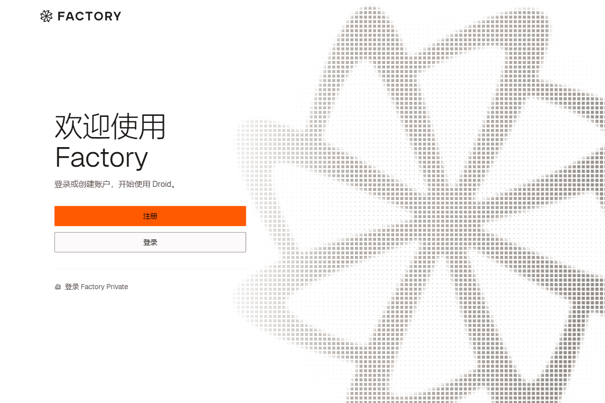

# Factory Desktop 简体中文语言包

为 **Windows x64 / Factory Desktop 0.205.0、0.204.0、0.202.0、0.201.0 标准安装版**提供全量静态界面词典。自动识别客户端版本，通过客户端自己的 i18next 词典和语言切换机制加载中文。

**v0.3.2 已适配 Factory 0.205.0 和 0.204.0，并继续支持 0.202.0、0.201.0。** 0.205.0 的 17,649 个界面词条和 81 个原生菜单、对话框词条均已处理，其中 17,428 项译为中文，302 项为品牌、命令、快捷键、单位或纯插值格式，逐项记录理由后保留。0.204.0 同样完整处理 17,943 个界面词条和 81 个原生词条；四版都要求零缺译，不能用英文回退满足覆盖率。两次上游更新在共享稳定 sourceID 尾部追加 397 条不同原文，不重排旧 ID。

另外审核了 0.205.0 的 1,538 处 JSX、界面字段和本地静态提示候选，补充本地化 601 处；其余 937 处为图标、语法标签、品牌、内部判别键、协议数据或原始诊断数据，按具体位置保留。动态工具名称只在显示读取边界翻译，不改内部映射键或用户内容。29 个成就徽章的 87 条文字在显示边界本地化，保留内部名称和原始统计数据；其中 1 条 Go 代码保持原样。系统界面、用户内容、模型输出和服务端动态内容不属于这份静态词典的覆盖计数。



## 使用

1. 从 Releases 下载 `Factory-Desktop-zh-CN-v0.3.2.zip` 并解压到普通文件夹。
2. 正常退出 Factory，然后双击 `install.cmd`。
3. 重新打开 Factory。中文系统会按系统语言选择简体中文；如果已有其他语言偏好，在 **Settings → General → Language** 中选择 **简体中文**。

双击 `status.cmd` 查看状态；正常退出 Factory 后双击 `restore.cmd` 恢复原版。脚本不自动结束正在运行的会话。

已安装旧汉化包时，退出 Factory 后直接运行新版 `install.cmd` 即可升级，无需先恢复。相同客户端版本的原版备份继续保留。Factory 自动升级会替换应用资源，升级到本包支持的版本后重新运行 `install.cmd` 即可；不会把旧客户端备份写入新版本。

已安装 Node.js 22 或更新版本时直接复用。否则脚本从 nodejs.org 下载固定版本的便携 Node.js，校验预置 SHA256 后缓存；无需全局安装，也不运行 npm install。运行语言包不需要翻译服务、API Key 或常驻调试端口。

命令行可显式指定 `app-x.y.z` 安装目录：

```powershell
powershell.exe -NoProfile -ExecutionPolicy Bypass -File .\factory-zh.ps1 -Action install -InstallDir "$env:LOCALAPPDATA\Factory\app-0.205.0"
```

`-Action` 支持 `install`、`status`、`restore`。只在启动本次脚本时使用 ExecutionPolicy 参数，不更改系统策略。

## 修改与恢复范围

安装时备份并修改安装目录内的 `resources/app.asar` 和 `factory-desktop.exe`。中文词典加入现有语言加载表；首屏挂载前先应用已保存的语言偏好，避免编译缓存固定英文。新版启动页的六条快捷键提示同时补齐，并在构建时校验实际词典结构。18 个直接受影响组件订阅语言变化，仅使自身的编译缓存失效，保留用户状态。模块级显示字段通过延迟读取取得当前语言，保留赋值行为。英文回退继续用于其他语言及异常情况，不修改模型提示词、工具权限、命令、账户或会话内容。配置加载之前的少量致命启动提示按系统首选语言显示。

Factory 启用了 ASAR 完整性验证，因此安装脚本会重新计算修改后资源的哈希，并更新 EXE 的 `ElectronAsar` 哈希记录，**不关闭完整性校验或修改 Electron fuses**。EXE 内容改变后，**原官方 Authenticode 签名会失效**；恢复备份后原文件和签名一并还原。当前版本不存在已确认的外部语言包导入目录，本项目需要登记并打包中文模块。

备份保存在当前 `app-x.y.z/.factory-zh-cn/`，约需 300 MB；安装时还需要临时空间。请保留该目录以便恢复。重复安装相同包只校验后跳过写入。更新汉化包会从已验证的原版备份重新生成，不叠加旧补丁。写入失败会尝试恢复到操作前的文件；异常中断造成已知的新旧文件混合时可运行 `restore.cmd` 恢复。断电遗留的 `install.lock` 必须在确认没有安装进程后移除。

仅接受适配清单中的完整版本和文件指纹。未知版本或第三方改动时会拒绝覆盖；不会用旧备份覆盖新版本，不关闭 Factory 的自动更新。目前不支持 Windows ARM64、macOS、MSIX / WindowsApps。

## 开发与验证

```powershell
npm ci
npm run extract
npm run build
npm run check
npm test
powershell.exe -NoProfile -File tools/package.ps1
```

提取和构建默认使用本机最新适配版本的原版 Factory。也可运行 `node tools/build-pack.mjs <原版ASAR路径> 0.201.0` 构建指定版本词典。提取器只解析资源中的静态对象，不执行客户端代码。生成的英文参考词典保存在 `.local/`，不提交或随语言包分发。

`translations/full/*.json` 是全量译文，以稳定 ID 对应 `profiles/<版本>.catalog.json` 中的源文指纹；新版只追加源文 ID，旧 ID 保持不变。`preserve-*.json` 逐项说明技术名称等保留原因。`translations/context-overrides.json` 和原有 `overrides.json`、`desktop.json` 提供按键修正，`translations/badges.json` 补充成就展示文案，`translations/loader.json` 提供启动页提示。`phrases.tsv` 保留首版共享译文记录，`hardcoded-texts.tsv` 保留补充文案的复核对照；实际完整加载值以全量 JSON 和按键覆盖为准。

构建要求原版键集合完全一致、零缺译、零空译，未变原文或没有汉字的值必须有具体保留说明。检查插值、富文本标签嵌套、Markdown 链接、普通 URL、内联代码和代码围栏。`pack/zh-CN.json` 为最新适配版本，较旧版本位于 `pack/<版本>/zh-CN.json`；分别记录中文译文、技术保留和覆盖总数。`profiles/<版本>.hardcoded.json` 记录各硬编码候选的处置、固定补丁位置和组件订阅入口，语言加载变量也按版本独立登记。

已在 Windows 原生环境中验证安装、重复安装、更新、恢复、中途失败回滚、未知文件拒绝和英文回退；客户端副本验证了中文登录页、英文/中文切换及重启后的偏好保留，并检查全部修改脚本的可解析性。增加了富文本错误、代码/链接保护、延迟字段赋值和语言切换缓存的回归检查，并复核高风险权限与计费文案。隔离验收未登录真实账户，因此未对全部登录后业务页面做交互验收。GitHub Actions 运行 Windows 检查与打包，不使用 WSL。

分发包只包含本项目脚本、译文和版本清单，不包含 Factory EXE、ASAR、用户配置、凭据或会话。

## 维护方式

维护默认由本地手动触发。在本项目聊天中发送“检查 Factory 更新并汉化发布”，即可从本地仓库执行版本检查、全量汉化适配、必要验证、提交、推送及正式发布。无更新时跳过重复构建和发布，不创建或恢复每日定时任务。

云端每日计划已停用，专用的 `Cloud Factory maintenance` 工作流已禁用，正常的 `Windows checks` CI 保持启用。既有云端执行桥保留供明确恢复时使用，日常本地维护不经过连接器控制 Issue。见 [维护说明与历史云端协议](docs/cloud-maintenance.md)。

技术依据：[Electron ASAR 完整性验证](https://www.electronjs.org/docs/latest/tutorial/asar-integrity)、[i18next 资源配置](https://www.i18next.com/overview/configuration-options)。
